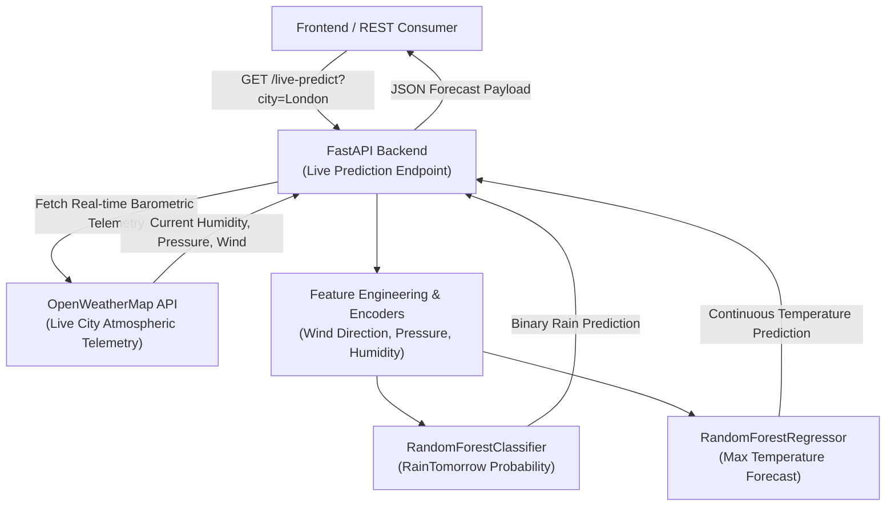

# ⛅ Weather ML & Live Prediction Service

[](https://fastapi.tiangolo.com)
[](https://python.org/)
[](https://scikit-learn.org/)
[](https://openweathermap.org/)

An automated weather forecasting pipeline that combines live meteorological data ingestion with pre-trained Random Forest machine learning models. Built with **FastAPI** and **scikit-learn**, the service queries live city weather metrics via the OpenWeatherMap API and predicts both continuous temperature variations and binary rain probability for the subsequent day.

---

## 🏗️ Architecture



---

## 🧠 Machine Learning Models & Dataset

- **Training Dataset:** Historical Australian daily weather dataset (`weatherAUS.csv`, ~145,000 observations over 10 years across meteorological stations).
- **Models:**
  1. **Rain Predictor (`rain_forest_model.joblib`):** `RandomForestClassifier` predicting binary `RainTomorrow` (Yes / No).
  2. **Temperature Forecaster (`temp_forest_model.joblib`):** `RandomForestRegressor` predicting continuous `MaxTemp`.
- **Encoders:** Categorical wind direction and location encodings persisted in `model/encoders.joblib`.

---

## 📂 Project Structure

```
Weather_ML_Project/
├── backend/
│   └── main.py               # FastAPI application with /live-predict endpoint
├── data/
│   ├── collect_weather.py    # Batch collection script
│   └── secrets.ini.example   # Configuration template for OpenWeatherMap API key
├── model/
│   ├── rain_forest_model.joblib  # Trained Random Forest classifier
│   ├── temp_forest_model.joblib  # Trained Random Forest regressor
│   ├── encoders.joblib           # Pre-fitted categorical encoders
│   ├── test_model.py             # Validation and offline prediction script
│   └── train_model.py            # Model training pipeline
├── .gitignore
└── README.md
```

---

## 🚀 Quickstart & Local Setup

### Prerequisites
- Python 3.10+
- Free OpenWeatherMap API key ([openweathermap.org/api](https://openweathermap.org/api))

### 1. Clone the Repository
```bash
git clone https://github.com/Narasimhamanam/Weather_ML_Project.git
cd Weather_ML_Project
```

### 2. Set Up Virtual Environment & Dependencies
```bash
python -m venv .venv

# On Windows:
.venv\Scripts\activate
# On macOS / Linux:
source .venv/bin/activate

pip install fastapi uvicorn requests scikit-learn joblib numpy pandas
```

### 3. Configure API Key
Configure your OpenWeatherMap key using either environment variables or `data/secrets.ini`:
```bash
# Option A: Environment Variable (Recommended)
export OPENWEATHER_API_KEY="your_api_key_here"

# Option B: secrets.ini file
cp data/secrets.ini.example data/secrets.ini
# Edit data/secrets.ini and insert your key
```

### 4. Run the API Service
```bash
cd backend
uvicorn main:app --reload --port 8000
```

### 5. Test Live Prediction
```bash
curl "http://localhost:8000/live-predict?city=London"
```

---

## ⚠️ Limitations & Honest Status

- **Geographic Bias:** The underlying Random Forest models were trained on historical Australian meteorological data (`weatherAUS.csv`); live inference predictions for equatorial or high-latitude cities may exhibit bias due to regional microclimate variance.
- **Atmospheric Imputation:** OpenWeatherMap's basic tier does not expose Sunshine hours or Evaporation; these are conservatively imputed with seasonal baseline constants.
